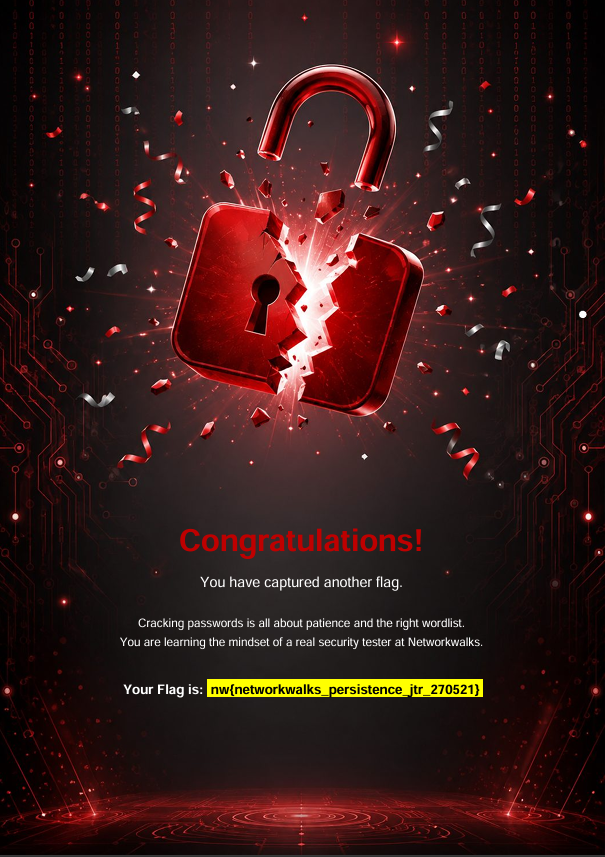
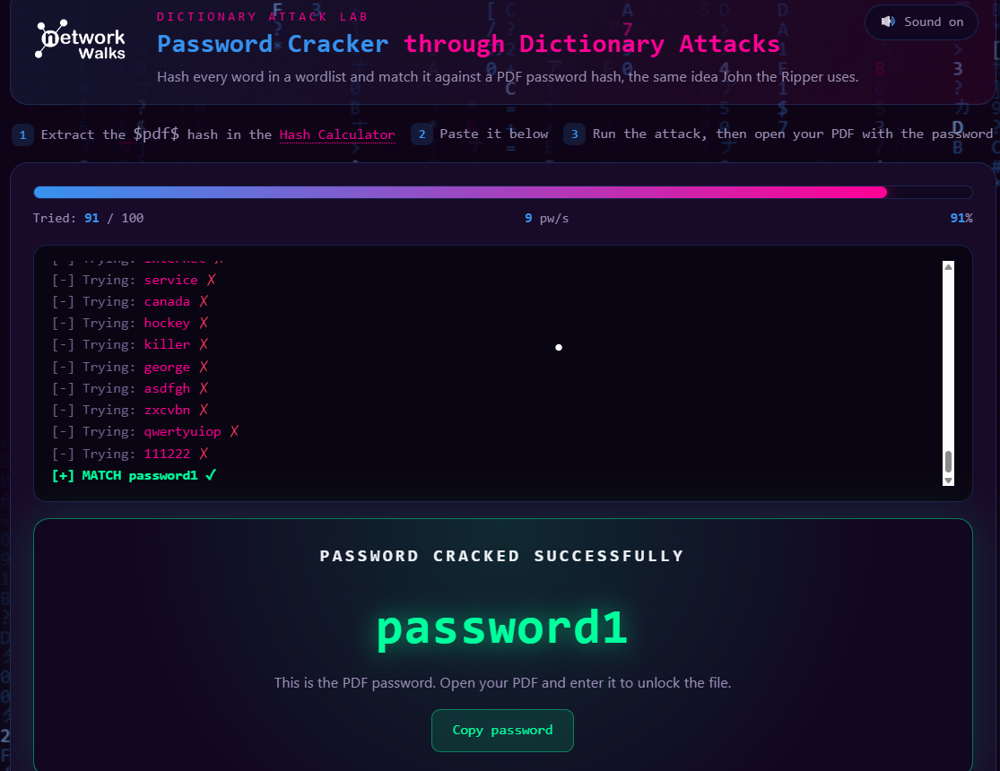
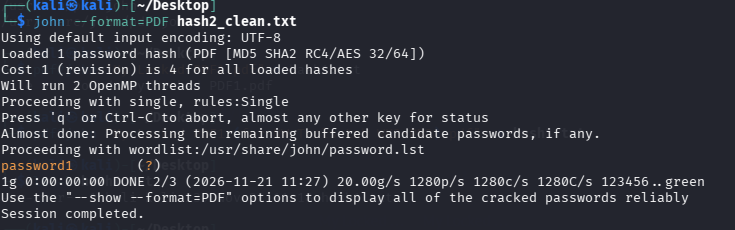
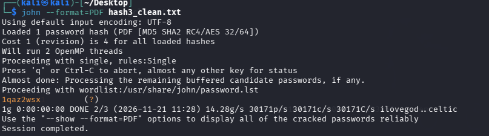

# 🔓 Password Cracking Lab – JTR & Networkwalks Tools

Recovering a password-protected PDF's password using dictionary attacks, with John the Ripper (CLI on Kali Linux) and the Networkwalks Hash Calculator / Password Cracker web tools.

`Skill: Cybersecurity` `Skill: Password Auditing` `Tool: John the Ripper` `Tool: Networkwalks Hash Calculator` 

---

## 📌 Project Overview

This project covers Week 3 of the Networkwalks Cybersecurity Internship, which focused on password security and dictionary-attack based cracking.

Two modules were completed:
- **PM1 – Password Cracking with JTR**: Extracting a crackable hash from a password-protected PDF and recovering the password using John the Ripper.
- **PM2 – Password Cracking with Networkwalks Tools**: Repeating the same recovery using Networkwalks' own browser-based Hash Calculator and Password Cracker tools.

---

## 🧰 Module 1: Password Cracking with JTR

### Steps
1. Extracted the PDF's hash using the OnlineHashCrack PDF hash extractor tool (`pdf2john` equivalent). See `screenshots/01_hash_extracted_onlinehashcrack.png`.
2. Saved the hash (starting with `$pdf$...`) into a clean text file, removing stray characters from the copy.
3. Loaded the hash file into **John the Ripper on Kali Linux** and ran a dictionary attack against `/usr/share/john/password.lst`.
4. John cracked the password successfully on two separate locked PDFs — `password1` and `1qaz2wsx`. See `screenshots/04_jtr_kali_cracked_password1.png` and `screenshots/05_jtr_kali_cracked_1qaz2wsx.png`.
5. Verified by opening the PDF with the recovered password — flag captured. See `screenshots/02_flag_pdf_unlocked.png`.

### Result
✅ Password recovered and PDF successfully unlocked.

---

## 🧰 Module 2: Password Cracking with Networkwalks Tools

### Steps
1. Uploaded the locked PDF to the Networkwalks **Hash Calculator** → extracted the `$pdf$...` hash.
2. Pasted the hash into the Networkwalks **Password Cracker** tool.
3. Ran the dictionary attack (built-in wordlist, 100 passwords).
4. Tool returned a successful match: `password1`. See `screenshots/03_networkwalks_password_cracker_result.png`.
5. Verified by opening the PDF with the recovered password.

### Result
✅ Password recovered and PDF successfully unlocked — confirming the same result obtained with JTR.

---

## ⚠️ Issue Faced & Troubleshooting

While attempting Module 1 on Windows, running `john.exe` through the **Johnny GUI** for the first time caused the Johnny window to spawn uncontrollably — 100+ duplicate windows opening continuously. The process had to be force-closed and the install removed. On reinstalling, even launching Johnny alone triggered the same window-spawning glitch.

**Workaround used:** Switched to **Kali Linux** and ran John the Ripper directly from the terminal (`john --format=PDF hash_clean.txt`), which completed the dictionary attack cleanly with no issues on the first try. Command-line JTR on Kali is the recommended fallback if the Windows Johnny GUI misbehaves — it avoids the extra GUI dependency layer entirely.

---

## 🔑 Key Learnings
- How password hashes are extracted from protected files (hash extraction tools like pdf2john).
- How dictionary attacks work: hashing wordlist entries and comparing against the target hash until a match is found.
- Why weak/common passwords (`password1`, `1qaz2wsx`) are cracked almost instantly — reinforcing the need for strong, unique passwords.
- Practical tool troubleshooting — switching platforms (Windows GUI → Kali CLI) when a tool misbehaves, instead of getting stuck.

---

## 📂 Screenshots

### Hash extracted from locked PDF

### Locked PDF successfully unlocked with cracked password

### Networkwalks Password Cracker — successful match

### JTR on Kali Linux — cracked `password1`

### JTR on Kali Linux — cracked `1qaz2wsx`

---

## ⚖️ Disclaimer
This lab was performed strictly in an authorized training environment using files provided for educational purposes as part of the Networkwalks Cybersecurity Internship. No unauthorized systems were accessed.

---

**Networkwalks Cybersecurity Internship | Batch B084**
